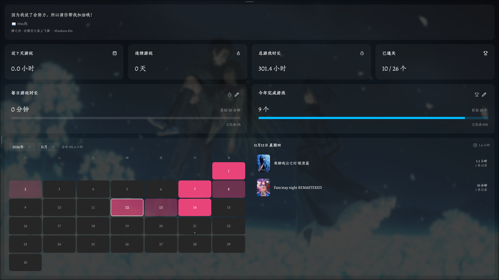
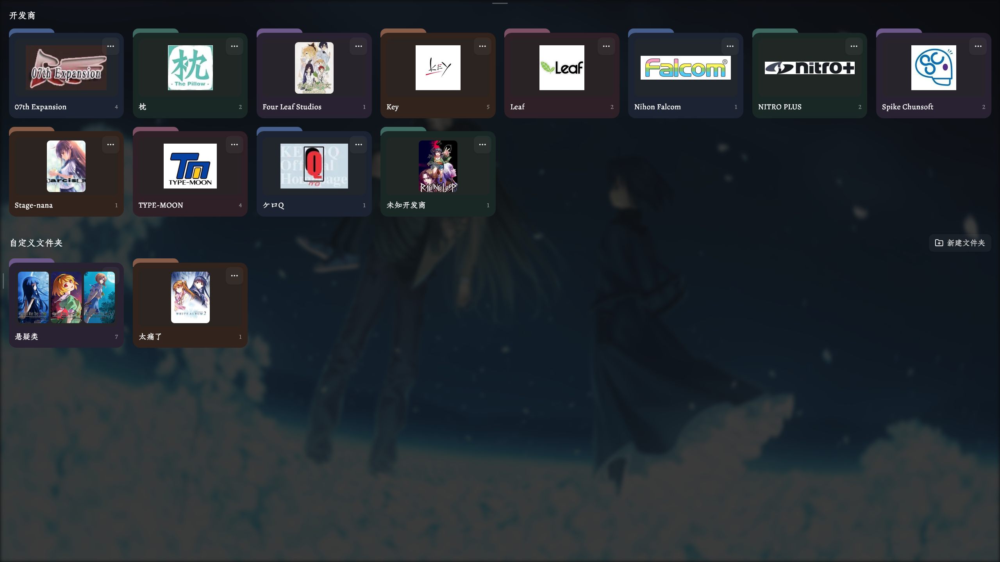
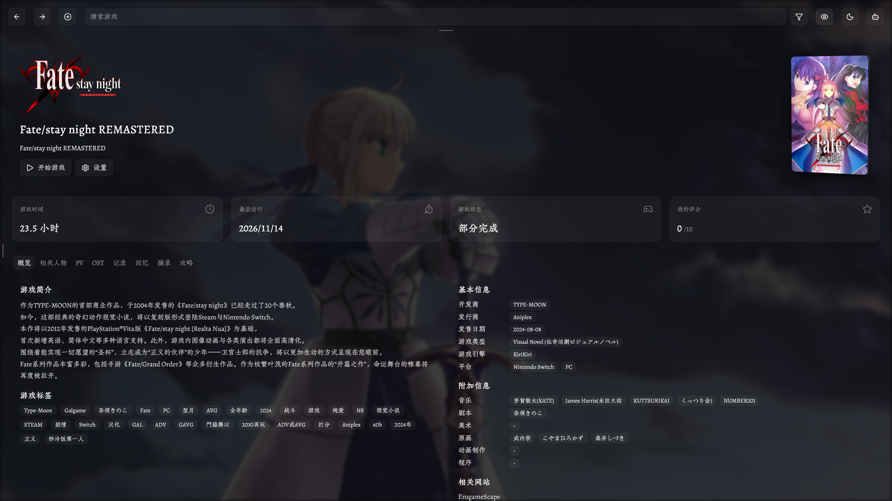
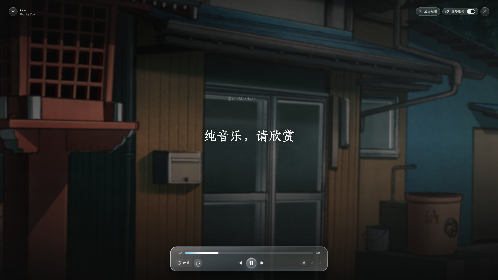
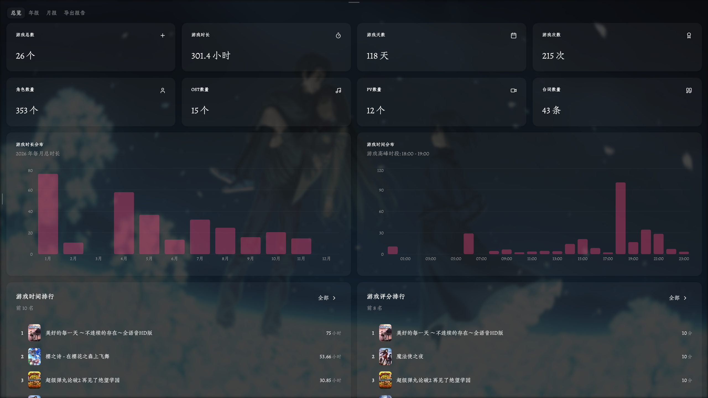
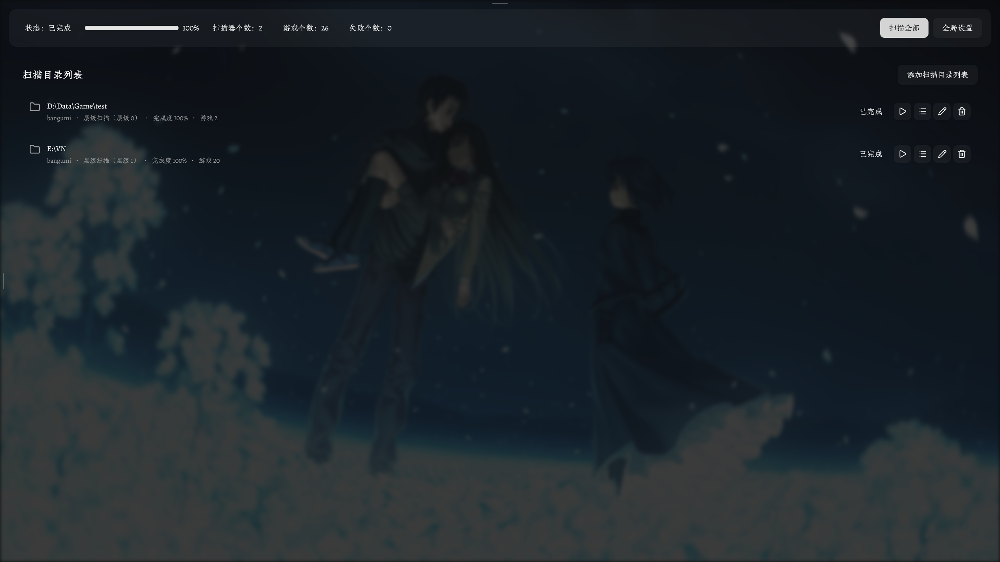
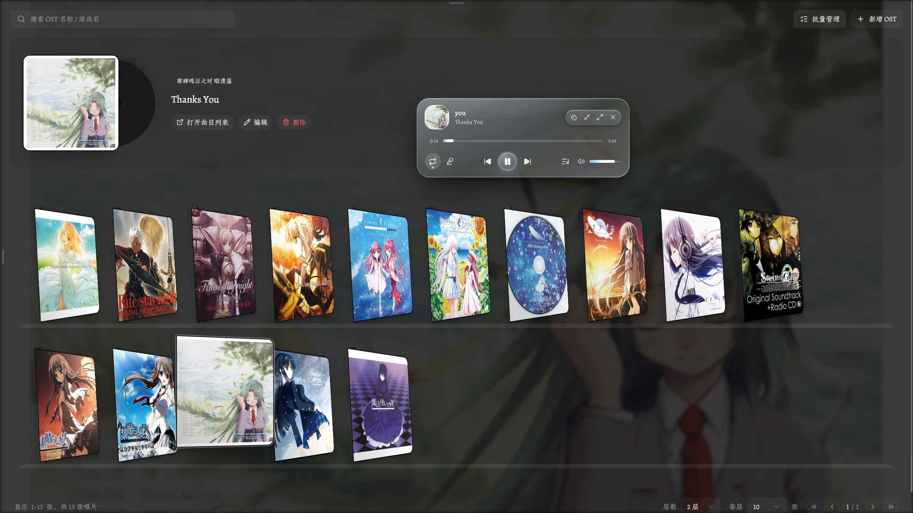
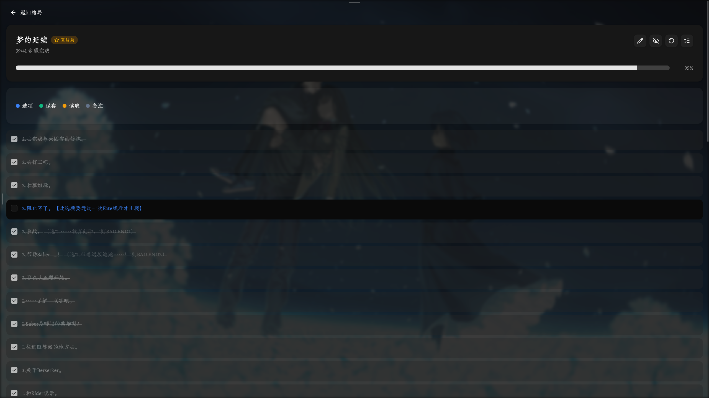
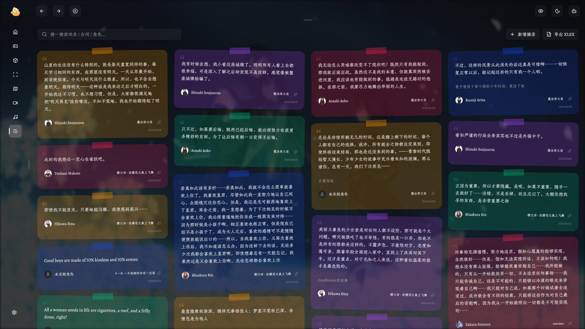
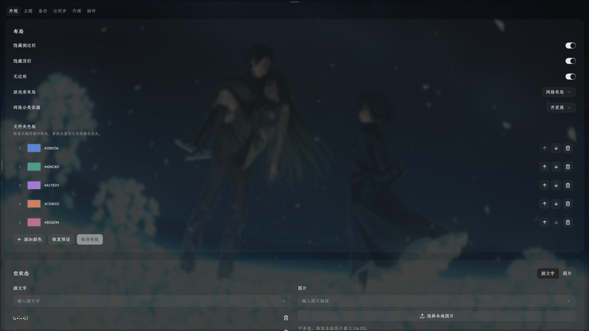

<a id="readme-top"></a>

<div align="center">
  <a href="https://github.com/Halory-Ito/vnweb">
    
  </a>

  <h1>vnweb</h1>

  <p>A self-hosted web hub for visual novels and local PC games — Library · Launcher · Media Organizer</p>

  <p><a href="./README.md">简体中文</a> · <strong>English</strong></p>

  <p>
    <a href="https://github.com/Halory-Ito/vnweb/stargazers"></a>
    <a href="https://github.com/Halory-Ito/vnweb/network/members"></a>
    <a href="https://github.com/Halory-Ito/vnweb/issues"></a>
    <a href="./LICENSE"></a>
    <a href="https://nextjs.org/"></a>
    <a href="https://react.dev/"></a>
    <a href="https://www.typescriptlang.org/"></a>
  </p>

  <p>
    <a href="#features">Features</a> ·
    <a href="#screenshots">Screenshots</a> ·
    <a href="#quick-start">Quick Start</a> ·
    <a href="#ai-assistant-and-webmcp">AI Assistant</a> ·
    <a href="#cli">CLI</a> ·
    <a href="./ROADMAP.md">Roadmap</a> ·
    <a href="docs/guide/intro/what-is-vnweb.md">Docs</a> ·
    <a href="https://github.com/Halory-Ito/vnweb/issues/new">Issues</a>
  </p>
</div>



> [!NOTE]
> On Windows x64, download `*_x64-setup.exe` from the [latest release](https://github.com/Halory-Ito/vnweb/releases/latest). GitHub Actions builds the desktop app when a push to `main` changes the Tauri version. See Quick Start below to run from source.

## Project Vision

**Open-source, local-first, agent-native infrastructure for digital culture.** Starting with visual novels, vnweb brings scattered community metadata, media, and personal play records into a self-hosted library. Its WebMCP tools and interactive generative UI explore how people and agents can manage that library together.

The long-term goal is to make works, characters, and narrative material easier to connect, search, and reuse across sources while giving users control over which data stays local and which data external services can process. vnweb aims to publish open-source components and reference implementations for cultural knowledge graphs, narrative understanding, and agent tool integration.

## Features

| Module                       | Highlights                                                                                                                                                                                                                                                                    |
| ---------------------------- | ----------------------------------------------------------------------------------------------------------------------------------------------------------------------------------------------------------------------------------------------------------------------------- |
| **Dashboard & Analytics**    | Quick stats (last 7 days, streak, total hours, completed), daily & yearly goal tracking, monthly heatmap, session duration distribution, leaderboards, and period report exports                                                                                              |
| **Library & Scanner**        | Multi-folder / recursive / executable scanning with exclude rules; 4 layouts (Folder, List, Grid, Hybrid); collections, multi-axis sorting/filtering, batch actions, and auto playtime tracking                                                                               |
| **Metadata & Platform Sync** | Pull metadata and artwork from Steam, VNDB, Bangumi (Personal Access Token + mirrors), YMGal, and SteamGridDB; sync Steam playtime and push play status mappings to Bangumi & VNDB                                                                                            |
| **Media, Memories & Guides** | PV (HLS, direct video, Bilibili, YouTube), OST (NetEase search/ID import, Meting SDK & Enhanced API, fullscreen player), Memories (MDX, frontmatter, custom metadata, OST auto-play), Quotes (XLSX export), and Guides (`yjgalgame` or AI JSON import, drag-and-drop sorting) |
| **AI Assistant & WebMCP**    | OpenAI-compatible streaming chat with collapsible reasoning and image/text attachments, interactive Generative UI cards, and 7 built-in WebMCP tools                                                                                                                          |
| **Theming & Backup**         | Custom local fonts, per-theme/mobile backgrounds, glassmorphism, and semantic colors; local & auto save-on-exit backups plus WebDAV / S3 remote sync with category selection, progress tracking, and pre-transfer summaries                                                   |

## Screenshots

|            Library (4 Layouts)             |              Game Details              |
| :----------------------------------------: | :------------------------------------: |
|           |  |
|        **Fullscreen Music Player**         |         **Analytics Overview**         |
|  |         |

<details>
<summary>More Screenshots (5)</summary>

|         Scanner & Import         |             OST Manager              |
| :------------------------------: | :----------------------------------: |
|     |  |
|      **Walkthrough Guides**      |          **Quote Excerpts**          |
|      |          |
| **Appearance & System Settings** |                                      |
|    |                                      |

</details>

## Quick Start

**Prerequisites**: Node.js ≥ 20.9 · npm · Windows (recommended)

### Windows One-Click Setup

After cloning, double-click `init.bat` in the project root. It checks your Node.js/npm environment, installs dependencies, copies missing configs from `data/example/` to `data/settings/`, initializes SQLite, builds the production bundle, and adds the repo directory to your user `PATH`. You can then run `vnweb` from any terminal (default port `8999`).

> [!WARNING]
> If a database already exists, `init.bat` moves it (along with `-wal`, `-shm`, and `-journal` files) to `backups/db/` before creating a fresh empty database. Stop any running `vnweb` server and Drizzle Studio first.

### Manual Setup

```bash
git clone https://github.com/Halory-Ito/vnweb.git
cd vnweb
npm install
npm run db:push

# Development (http://localhost:3000)
npm run dev

# Production (http://localhost:8999)
npm run build && npm run start
```

### Configuration

- **Platform Credentials**: Configure Steam, Bangumi, VNDB, YMGal, SteamGridDB, Meting SDK, and Enhanced API under **Settings → Platform** (stored in `data/settings/platform.json`; templates live in `data/example/`).
- **Database Path**: Defaults to `file:./local.db`. Update `dbFileName` in `data/settings/general.json` and restart to use another SQLite file.

## AI Assistant and WebMCP

The top-bar **AI Assistant** (Chat / WebMCP / Provider Config) supports OpenAI-compatible streaming chat, collapsible reasoning, and image/text attachments (including pasted screenshots). Supported tools render interactive **Generative UI** cards whose selections are sent back to the model to continue the workflow.

| Tool                   | Description                                                                                    |
| ---------------------- | ---------------------------------------------------------------------------------------------- |
| `add_game_to_library`  | Search by title and add a game with SteamGridDB covers, backgrounds, icons, and logos          |
| `sync_game_characters` | Sync character profiles and portraits via bound external sources or IDs                        |
| `sync_game_pv`         | Sync Steam trailers, or render selectable candidate cards when no Steam AppID is bound         |
| `search_game_ost`      | Search OST albums on khinsider / NetEase Cloud Music with multi-select candidate cards         |
| `import_game_ost`      | Import selected OST albums in full or by chosen tracks (skips existing album names by default) |
| `import_game_guide`    | Parse uploaded guide text into structured JSON and import it into a target game                |
| `export_quotes_xlsx`   | Filter quotes by keyword or creation date and export them to XLSX                              |

## CLI

`vnweb.bat` in the repository root launches the web server when called without arguments, or runs the CLI when given subcommands (recommended with the project root added to `PATH`).

```sh
vnweb --help              # Show command help
vnweb list game           # List all games (alias: list g)
vnweb list g -p 2 -s 10   # Paginate games (page 2, 10 items per page)
vnweb list collection     # List all collections (alias: list c)
vnweb open Favorites      # List games in a collection (by name or ID)
vnweb search "White Album" # Search games by title (supports -p / -s)
vnweb start 12            # Launch game #12 and track playtime (press q to stop; alias: s)
vnweb start               # Quick-launch the most recently played game
```

## Tech Stack

| Layer                | Technologies                                                                                     |
| -------------------- | ------------------------------------------------------------------------------------------------ |
| **Framework**        | Next.js 16 (App Router / Turbopack), React 19, TypeScript 5                                      |
| **UI & Motion**      | Tailwind CSS 4, shadcn/ui (Radix UI), Lucide, Recharts, Motion                                   |
| **Data & Storage**   | SQLite (libSQL), Drizzle ORM, TanStack Query 5, Jotai, axios                                     |
| **Media, Sync & AI** | hls.js, `@meting/core`, ExcelJS, MDX / react-markdown, webdav, `@aws-sdk/client-s3`, `usewebmcp` |
| **Tooling**          | oxlint, oxfmt, VitePress, `tsx`                                                                  |

<details>
<summary>Available Scripts</summary>

| Script                                    | Description                                         |
| ----------------------------------------- | --------------------------------------------------- |
| `npm run dev`                             | Start the development server (`localhost:3000`)     |
| `npm run build` / `npm run start`         | Build and start the production server (port `8999`) |
| `npm run cli`                             | Run the CLI (`cmd/tui.ts`)                          |
| `npm run db:push` / `npm run db:init`     | Push `db/schema.ts` to the SQLite database          |
| `npm run db:studio`                       | Launch Drizzle Studio (`127.0.0.1:5123`)            |
| `npm run lint` / `npm run lint:fix`       | Lint and auto-fix with oxlint                       |
| `npm run fmt` / `npm run fmt:check`       | Format and verify formatting with oxfmt             |
| `npm run docs:dev` / `npm run docs:build` | Preview or build the VitePress docs site (`docs/`)  |

</details>

## Roadmap

Proposed work includes multimodal narrative understanding, semantic knowledge graphs, spoiler-aware GraphRAG based on play progress, and permission controls and evaluation for agent workflows. The public roadmap also tracks the CG gallery and patch manager. See the [roadmap](./ROADMAP.md) and follow individual tasks in [Issues](https://github.com/Halory-Ito/vnweb/issues).

## Contributing

Contributions are welcome: Fork → create a feature branch → commit your changes → open a Pull Request. Before submitting, run `npm run lint && npm run fmt:check && npm run build`.

## License

Licensed under the [GNU Affero General Public License v3.0 (AGPL-3.0)](./LICENSE). See [LICENSE](./LICENSE) for details.

## Acknowledgments

Powered by metadata and guide sources from [VNDB](https://vndb.org/), [Bangumi](https://bgm.tv/), [Steam](https://store.steampowered.com/), [YMGal](https://www.ymgal.games/), [SteamGridDB](https://www.steamgriddb.com/), and [yjgalgame](https://www.yjgalgame.com/), alongside open-source tools including [Next.js](https://nextjs.org/), [React](https://react.dev/), [shadcn/ui](https://ui.shadcn.com/), and [Drizzle ORM](https://orm.drizzle.team/).

<p align="right">(<a href="#readme-top">Back to top</a>)</p>
