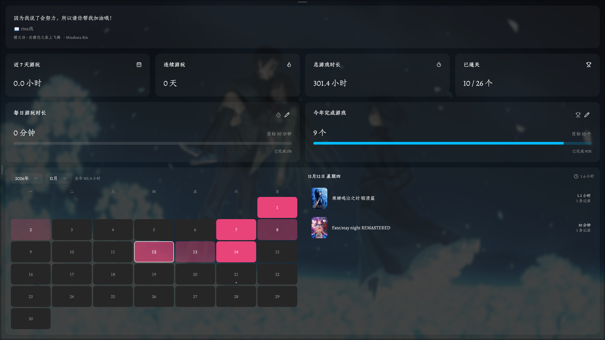
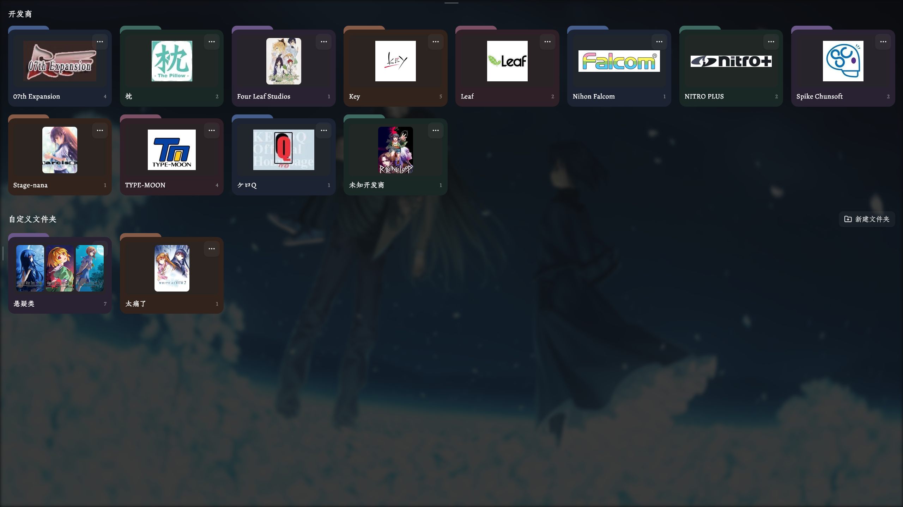
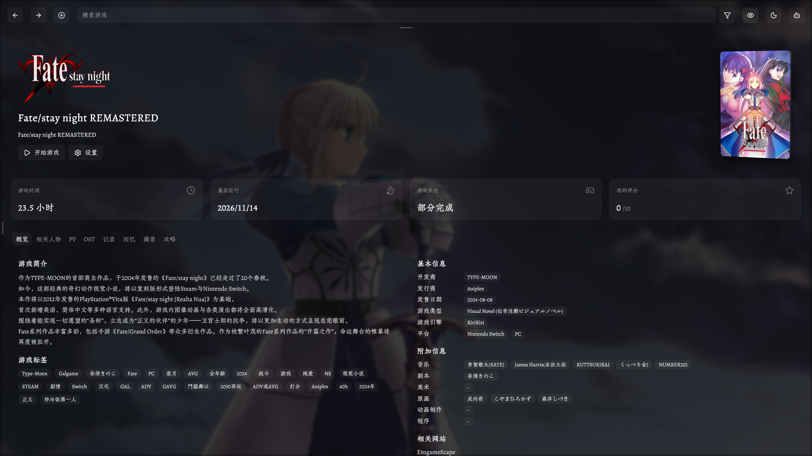
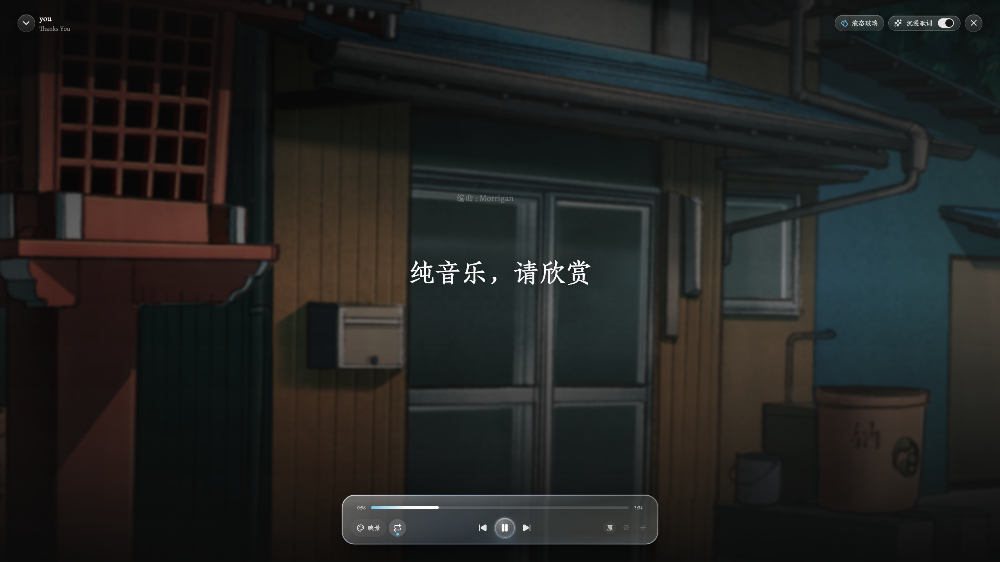
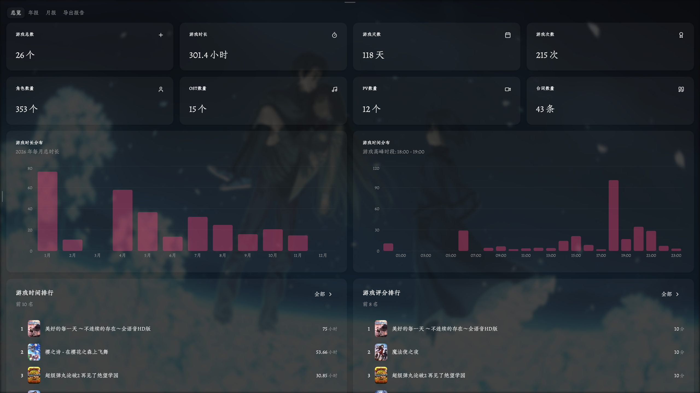
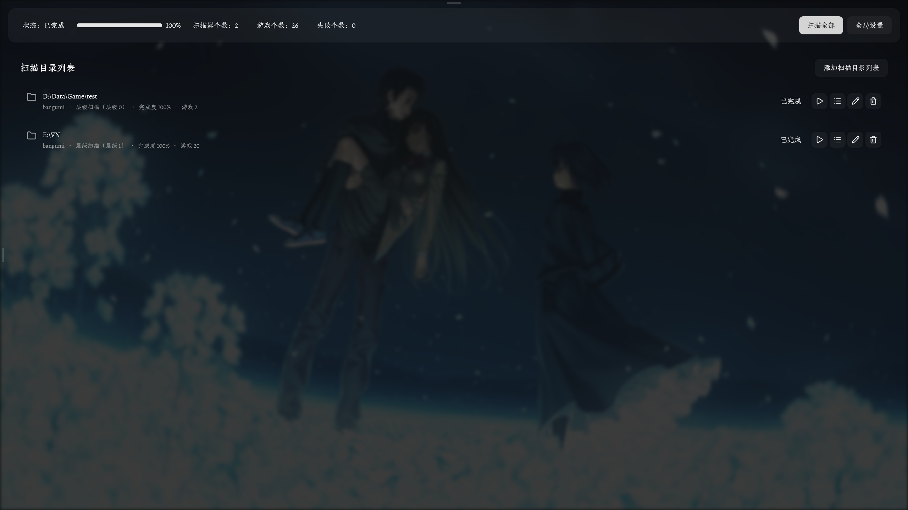
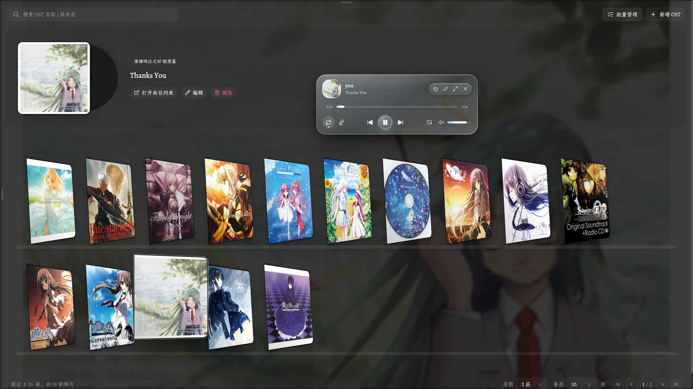
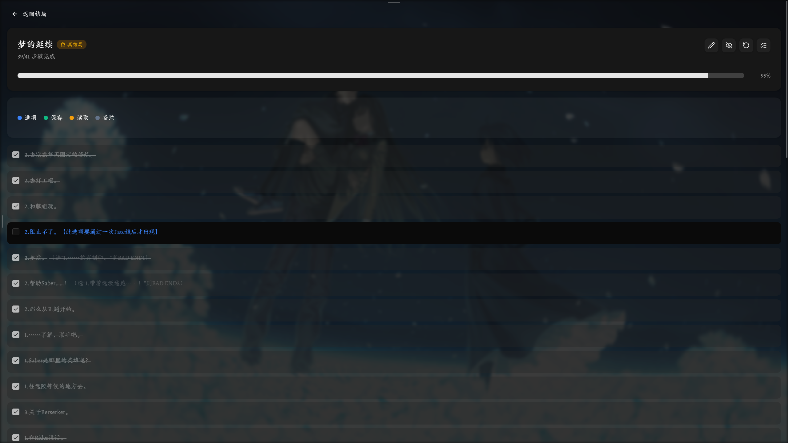
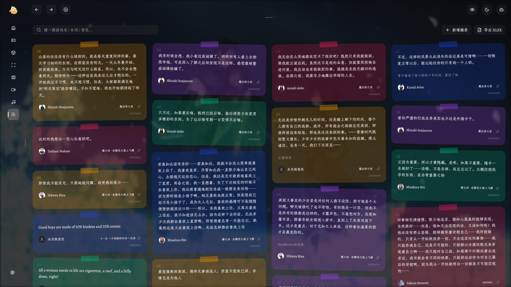
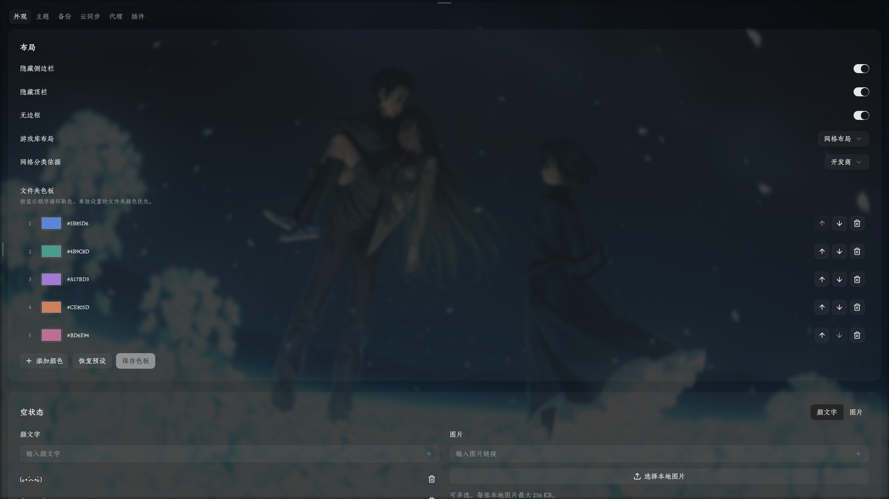

<a id="readme-top"></a>

<div align="center">
  <a href="https://github.com/Halory-Ito/vnweb">
    
  </a>

  <h1>vnweb</h1>

  <p>面向视觉小说与本地单机游戏的 Web 管理面板 —— 本地资料库 · 游戏启动器 · 媒体整理器</p>

  <p><strong>简体中文</strong> · <a href="./README.en.md">English</a></p>

  <p>
    <a href="https://github.com/Halory-Ito/vnweb/stargazers"></a>
    <a href="https://github.com/Halory-Ito/vnweb/network/members"></a>
    <a href="https://github.com/Halory-Ito/vnweb/issues"></a>
    <a href="./LICENSE"></a>
    <a href="https://nextjs.org/"></a>
    <a href="https://react.dev/"></a>
    <a href="https://www.typescriptlang.org/"></a>
  </p>

  <p>
    <a href="#功能特性">功能特性</a> ·
    <a href="#界面预览">界面预览</a> ·
    <a href="#快速开始">快速开始</a> ·
    <a href="#ai-助手与-webmcp">AI 助手</a> ·
    <a href="#命令行工具">命令行工具</a> ·
    <a href="docs/guide/intro/what-is-vnweb.md">文档</a> ·
    <a href="https://github.com/Halory-Ito/vnweb/issues/new">问题反馈</a>
  </p>
</div>



> [!NOTE]
> Windows x64 用户可在[最新 Release](https://github.com/Halory-Ito/vnweb/releases/latest)下载 `*_x64-setup.exe`。源码运行方式见下方「快速开始」。

## 功能特性

| 模块                 | 核心能力                                                                                                                                                                                                                                |
| -------------------- | --------------------------------------------------------------------------------------------------------------------------------------------------------------------------------------------------------------------------------------- |
| **主页与统计**       | 游玩速览（近 7 天 / 连续天数 / 总时长 / 已通关）、每日与年度目标追踪、按月热力图、单次时长分布、排行榜与周/月/年报告导出                                                                                                                |
| **游戏库与扫描**     | 多目录 / 层级 / 可执行文件扫描与排除规则；文件夹 / 列表 / 网格 / 混合 4 种布局；收藏夹、多维筛选排序、批量操作与自动计时                                                                                                                |
| **多源刮削与联动**   | 接入 Steam、VNDB、Bangumi（个人令牌与镜像）、YMGal、SteamGridDB 补全资料与图片；支持 Steam 时长同步与 Bangumi / VNDB 状态推送                                                                                                           |
| **媒体、回忆与攻略** | PV（HLS / 视频直链 / Bilibili / YouTube）、OST（网易云搜索与 ID 导入 / Meting SDK / Enhanced API / 全屏播放器）、回忆（MDX / frontmatter / 自定义元数据 / 配乐自动播放）、台词（XLSX 导出）、攻略（yjgalgame / AI JSON 导入与拖拽排序） |
| **AI 助手与 WebMCP** | OpenAI 兼容流式对话（思考过程折叠、图片与文本附件），支持可交互生成式 UI 卡片与 7 项内置 WebMCP 工具                                                                                                                                    |
| **外观定制与备份**   | 自定义字体、明暗及移动端背景、毛玻璃与主题语义色；本地与退出自动备份存档，以及支持分类选择、进度条与预览统计的 WebDAV / S3 远程同步                                                                                                     |

## 界面预览

|            游戏库（四种布局）            |              游戏详情              |
| :--------------------------------------: | :--------------------------------: |
|          |  |
|            **全屏音乐播放器**            |            **统计总览**            |
|  |      |

<details>
<summary>查看更多界面截图（5 张）</summary>

|           扫描与导入           |             OST 管理              |
| :----------------------------: | :-------------------------------: |
|    |  |
|          **游戏攻略**          |           **台词摘录**            |
|    |     |
|       **外观与系统设置**       |                                   |
|  |                                   |

</details>

## 快速开始

**环境要求**：Node.js ≥ 20.9 · npm · Windows（推荐）

### Windows 一键初始化

克隆仓库后双击根目录 `init.bat`：脚本会自动检查环境、安装依赖、从 `data/example/` 补齐 `data/settings/` 缺失配置、初始化数据库、构建生产版本，并将项目目录加入用户 `PATH`。完成后在任意终端运行 `vnweb` 即可启动（默认端口 `8999`）。

> [!WARNING]
> 若已存在数据库文件，`init.bat` 会先将其连同 `-wal` / `-shm` / `-journal` 备份至 `backups/db/` 后再重建空库。运行前请关闭正在运行的 `vnweb` 服务与 Drizzle Studio。

### 手动安装

```bash
git clone https://github.com/Halory-Ito/vnweb.git
cd vnweb
npm install
npm run db:push

# 开发环境 (http://localhost:3000)
npm run dev

# 生产环境 (http://localhost:8999)
npm run build && npm run start
```

### 配置说明

- **平台凭证**：启动后前往「设置 → 平台」配置 Steam、Bangumi、VNDB、YMGal、SteamGridDB、Meting SDK 与 Enhanced API（保存于 `data/settings/platform.json`，模板见 `data/example/`）。
- **数据库路径**：默认为根目录 `file:./local.db`，可在 `data/settings/general.json` 修改 `dbFileName` 后重启应用生效。

## AI 助手与 WebMCP

顶栏内置 **AI 助手**（对话 / WebMCP / 模型配置），支持 OpenAI 兼容模型流式对话、思考过程折叠与图片/文本附件（可直接粘贴截图）。工具调用结果会渲染为可交互的**生成式 UI** 卡片，点选确认后自动回传模型继续处理。

| 工具                   | 说明                                                                  |
| ---------------------- | --------------------------------------------------------------------- |
| `add_game_to_library`  | 按名称搜索并加入游戏库，自动从 SteamGridDB 配置封面、背景、图标与徽标 |
| `sync_game_characters` | 同步指定游戏的角色资料与立绘，支持按数据源与外链 ID 绑定              |
| `sync_game_pv`         | 同步 Steam 预告片；未绑定时按名称搜索并渲染候选卡片供点选             |
| `search_game_ost`      | 在 khinsider / 网易云搜索 OST 专辑，返回可多选的候选卡片              |
| `import_game_ost`      | 批量或挑选曲目导入所选 OST 专辑（同名专辑默认跳过）                   |
| `import_game_guide`    | 将上传的攻略文本整理为结构化 JSON 并导入指定游戏                      |
| `export_quotes_xlsx`   | 按关键词或创建时间筛选并导出台词摘录为 XLSX 文件                      |

## 命令行工具

根目录提供 `vnweb.bat`：无参数时启动 Web 服务，带参数时进入命令行模式（建议将项目根目录加入 `PATH`）。

```sh
vnweb --help              # 查看帮助
vnweb list game           # 列出所有游戏（简写 list g）
vnweb list g -p 2 -s 10   # 分页列出第 2 页，每页 10 条
vnweb list collection     # 列出所有收藏夹（简写 list c）
vnweb open 我的收藏       # 查看指定收藏夹中的游戏（支持名称或 ID）
vnweb search 白色相簿     # 按名称搜索游戏（支持 -p / -s 分页）
vnweb start 12            # 启动游戏并计时，按 q 结束并保存（简写 s）
vnweb start               # 快速启动最近一次游玩的游戏
```

## 技术栈

| 分类                | 技术与依赖                                                                                       |
| ------------------- | ------------------------------------------------------------------------------------------------ |
| **框架**            | Next.js 16 (App Router / Turbopack)、React 19、TypeScript 5                                      |
| **UI 与动效**       | Tailwind CSS 4、shadcn/ui (Radix UI)、Lucide、Recharts、Motion                                   |
| **数据与存储**      | SQLite (libSQL)、Drizzle ORM、TanStack Query 5、Jotai、axios                                     |
| **媒体、同步与 AI** | hls.js、`@meting/core`、ExcelJS、MDX / react-markdown、webdav、`@aws-sdk/client-s3`、`usewebmcp` |
| **工程工具**        | oxlint、oxfmt、VitePress、`tsx`                                                                  |

<details>
<summary>常用脚本</summary>

| 命令                                      | 说明                                     |
| ----------------------------------------- | ---------------------------------------- |
| `npm run dev`                             | 启动开发环境（端口 3000）                |
| `npm run build` / `npm run start`         | 构建并启动生产服务（端口 8999）          |
| `npm run cli`                             | 运行命令行工具（`cmd/tui.ts`）           |
| `npm run db:push` / `npm run db:init`     | 同步 `db/schema.ts` 到数据库             |
| `npm run db:studio`                       | 打开 Drizzle Studio（`127.0.0.1:5123`）  |
| `npm run lint` / `npm run lint:fix`       | 代码检查与自动修复（oxlint）             |
| `npm run fmt` / `npm run fmt:check`       | 格式化代码与格式检查（oxfmt）            |
| `npm run docs:dev` / `npm run docs:build` | 本地预览或构建 VitePress 文档（`docs/`） |

</details>

## 路线图

- [x] 主页仪表盘（数据速览 / 游玩热力图 / 目标追踪 / 随机摘录）
- [x] 游戏库、多目录扫描、多数据源导入与 Bangumi / VNDB 状态同步
- [x] 游戏详情（资料 / 人物 / PV / OST / 记录 / 回忆 / 摘录 / 攻略）
- [x] 统计总览、周期报告、外观定制与 WebDAV / S3 备份同步
- [x] AI 助手、WebMCP 工具与可交互生成式 UI
- [ ] CG 模块
- [ ] 补丁管理（启动时选择性开关补丁）

更多规划与进度见 [Issues](https://github.com/Halory-Ito/vnweb/issues)。

## 参与贡献

欢迎提交 Issue 或 Pull Request：Fork → 新建分支 → 提交改动 → 发起 PR。提交前建议先执行 `npm run lint && npm run fmt:check && npm run build`。

## 许可证

本项目基于 [GNU Affero General Public License v3.0 (AGPL-3.0)](./LICENSE) 开源，详情请参阅 [LICENSE](./LICENSE)。

## 致谢

感谢 [VNDB](https://vndb.org/)、[Bangumi](https://bgm.tv/)、[Steam](https://store.steampowered.com/)、[YMGal](https://www.ymgal.games/)、[SteamGridDB](https://www.steamgriddb.com/) 与 [yjgalgame](https://www.yjgalgame.com/) 提供资料与攻略来源，以及 [Next.js](https://nextjs.org/)、[React](https://react.dev/)、[shadcn/ui](https://ui.shadcn.com/)、[Drizzle ORM](https://orm.drizzle.team/) 等开源项目。

<p align="right">(<a href="#readme-top">回到顶部</a>)</p>
